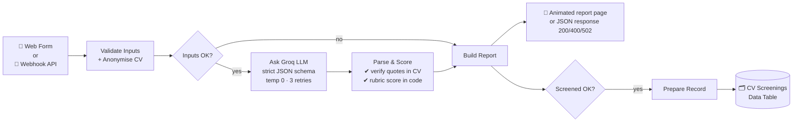

# AI CV Screening Assistant (n8n + Groq)

An evidence-based CV screening workflow that helps a **human recruiter** review candidates faster and more fairly.
It reads a CV and a job description, asks an LLM to judge each requirement **with exact quotes from the CV**, then **verifies those quotes and calculates the score in code**, so results are explainable and consistent.

> ⚠️ This is a decision-support tool, not a hiring decision-maker. Every report is labelled *"AI-assisted screening to support human review."*

**Built by:** Jyothika Kokkula · MSc Artificial Intelligence, Teesside University
**Stack:** n8n (self-hosted, Docker) · Groq API (`openai/gpt-oss-20b`) · JavaScript · n8n Data Tables · HTML/CSS

---

## ✨ Key features

| Feature | What it does | Why it matters |
|---|---|---|
| **Rubric scoring in code** | The LLM only rates each requirement (*met / partial / not evidenced / lacks*). JavaScript computes the 0–100 score from a fixed rubric. | LLMs give inconsistent numbers. Moving the maths into code makes scores repeatable and auditable. |
| **Hallucination check** | Every evidence quote the AI returns is searched for in the actual CV. Quotes that can't be found get **half credit** and are flagged for the reviewer. | Prevents the model inventing skills or experience. |
| **Anonymisation (fairness)** | Name, email, phone numbers and links are replaced with `[CANDIDATE]`, `[EMAIL]`, `[PHONE]`, `[LINK]` before the CV reaches the AI. | Reduces the chance of identity details influencing the assessment. |
| **"Not evidenced" ≠ "lacks"** | Distinguishes *the CV doesn't mention it* from *the CV shows the candidate doesn't have it*. | Avoids unfairly penalising candidates for things simply missing from a CV. |
| **Transferable skills** | Soft skills can be credited as *partial* from any job, study or volunteering. | Fairer to career changers. |
| **Strict structured output** | Groq JSON-schema mode (strict), temperature 0, fixed seed. Incomplete answers are rejected, never scored. | Reliable, machine-readable results. |
| **Error handling** | Input validation, 3 automatic retries on the AI call, clear `400` (bad input) / `502` (AI problem) responses. | Fails safely with readable messages instead of crashing. |
| **Two entry points** | A styled web **form** for people, and a **webhook** (JSON API) for other apps. | Shows both UI and API integration. |
| **Screening history** | Successful screenings are saved to an n8n Data Table (score, band, gaps, summary, CV text, date). | Lets a recruiter compare candidates later. |
| **Privacy notice** | The form tells applicants their details and CV are stored for recruitment review only. | Transparency, in line with UK GDPR principles. |

---

## 🏗️ Architecture



### Workflows
- **`CV Screening V2 - Form`**: Form → Validate → Inputs OK? → Ask Groq → Parse & Score → Build Report → Show Report, plus Screened OK? → Prepare Record → Save to History
- **`CV Screening V2 - Webhook`**: Webhook → Validate → Inputs OK? → Ask Groq → Parse & Score → Build Report → Send Response (`POST /webhook/cv-screening-v2`)

---

## 🧮 Scoring rubric

| Component | Weight |
|---|---|
| Required skills | 50% |
| Preferred skills | 20% |
| Relevant experience | 20% |
| Education | 10% |

- **Met** = full credit · **Partial** = half · **Not evidenced / Lacks** = none
- Credit is **halved** if the AI's quote cannot be found in the CV
- Experience: strong 100% · relevant 70% · limited 35% · none 0%
- Weights are re-balanced if a part doesn't apply (e.g. no education requirement, or education already listed as a skill, so it's never counted twice)

**Bands**
- 🟢 **Strong match**: score ≥ 75 and every required skill at least partly evidenced
- 🟡 **Possible match**: score ≥ 50 and no required skill explicitly lacking
- 🔴 **Weak match**: otherwise

---

## 🧪 Test results (synthetic candidates)

All test data is made up. No real applicant data was used.

| Test | Result |
|---|---|
| Strong candidate (data internship, Excel/SQL/Power BI/Python) | **82/100 · Strong match**, 100% of evidence quotes verified |
| Same CV, 3 repeated runs | **82, 82, 82**, identical skill ratings each time |
| Weak candidate (barista CV vs data analyst role) | **Weak match**, no skills invented |
| Career-changer CV mentioning *"basic SQL (online course)"* | SQL correctly rated **Partly met**, 76/100 |
| Missing CV + too-short job description + invalid email | **HTTP 400** with three clear error messages |
| AI request rejected by the provider | **HTTP 502** with a readable message (no crash) |
| Fabricated AI quote (unit test with a mocked AI response) | Detected as unverified, half credit, flagged for the reviewer |
| Form submission end-to-end | Report displayed and row saved to the data table |

> Note: after changing the prompt, one run of the same strong CV scored 84 instead of 82. LLM outputs can still vary slightly, but the score breakdown shows exactly which rating changed, so any difference is explainable.

---

## 🐞 Problems I solved along the way

1. **Old webhook broke on real CVs.** The CV was pasted directly into a JSON template, so line breaks and quotes produced invalid JSON. Fixed by building the request with `JSON.stringify`.
2. **Form couldn't use "Respond to Webhook".** Split form and webhook into separate workflows, each with the right ending node.
3. **AI stopped mid-answer**, silently scoring experience as 0. Fixed with strict JSON-schema output, and the scorer now refuses incomplete answers.
4. **n8n expression clash.** The JSON schema contained `}}`, which n8n reads as "end of expression". Fixed by spacing braces automatically.
5. **Double counting.** A degree listed as a preferred skill was also scored as education. The prompt now marks education as *not required* when it is already a skill.
6. **Report styling stripped.** The form's ending page removes inline styles, so the report uses clean HTML and all styling lives in the node's custom CSS.

---

## ⚖️ Limitations & responsible-use notes

- Runs locally (`localhost`); not deployed or authenticated. The webhook has **no authentication** yet.
- Accepts **pasted text** only (no PDF/Word parsing yet).
- Tested on a small set of synthetic CVs; a larger labelled test set is needed for proper accuracy and bias evaluation.
- The smaller model (`gpt-oss-20b`) is cautious with soft skills and can miss transferable evidence; a larger model may follow the rubric more closely.
- Anonymisation is pattern-based and won't catch every identifying detail (e.g. names of schools or clubs).
- AI in recruitment is a high-risk area. Outputs must always be reviewed by a person, and stored CVs should be deleted when no longer needed.

---

## 🚀 Roadmap

- [ ] Webhook authentication (header API key)
- [ ] PDF / Word CV upload and text extraction
- [ ] Rank multiple candidates for one job
- [ ] Evaluation set of 20+ CVs with expected outcomes, plus a name-swap bias test
- [ ] Automatic deletion of stored CVs after a retention period
- [ ] Error-notification workflow and run-time / cost logging

---

## 🛠️ Run it yourself

1. Run n8n (e.g. Docker: `docker run -it --rm -p 5678:5678 -v n8n_data:/home/node/.n8n docker.n8n.io/n8nio/n8n`).
2. In n8n, create a **Header Auth** credential: Name `Authorization`, Value `Bearer <your Groq API key>`.
3. Import the workflow JSON files: **Workflows → ⋯ → Import from File**.
4. Open each **Ask Groq** node and select your credential.
5. For the form version, create a Data Table named **CV Screenings** with columns:
   `candidate_name, email, job_title, band, required_met, gaps, summary, cv_text` (text) and `score, evidence_verified_pct` (number), then select it in **Save to History**.
6. Click **Execute** and open the form's test URL, or `POST` JSON to the webhook:

```json
{
  "candidateName": "Test Candidate",
  "email": "test@example.com",
  "jobTitle": "Junior Data Analyst",
  "cvText": "…CV text…",
  "jobDescription": "…job description…"
}
```

> 🔐 Never commit API keys. The exported workflow files contain no credentials.

---

## 👩‍💻 Author

**Jyothika Kokkula** · MSc Artificial Intelligence, Teesside University (UK)
Open to graduate / junior roles in AI engineering, AI automation and data.

[LinkedIn](https://www.linkedin.com/in/jyothikakokkula) · ✉️ [kokkulajyothika@gmail.com](mailto:kokkulajyothika@gmail.com)
